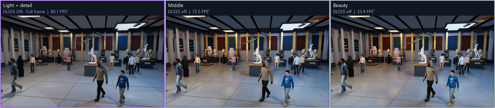
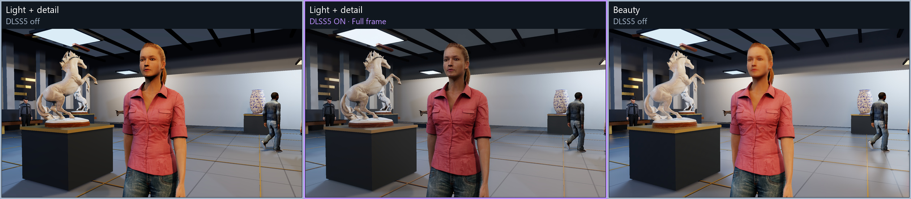
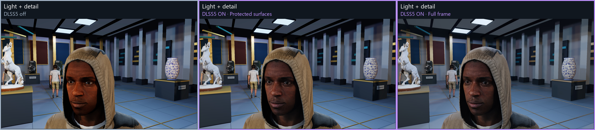

# DLSS5 Gallery

**Can cheaper rendering plus neural rendering produce an image we prefer, at a higher frame rate?**

This standalone Windows gallery explores that question. Compare seven rendering
budgets with DLSS5 off, applied to
selected surfaces, or applied to the full frame. Sixteen animated people, detailed
exhibits and two animals provide faces, clothing, hair, shadows and reflections to inspect.

The goal is to find which conventional features give neural rendering useful input,
and which expensive effects can be simplified. The performance condition is simple:

```text
saved rendering time > neural rendering + conversion + compositing cost
```

Visual quality still has to be judged separately, including in motion. The current
results measure DLSS5 NR at native 1080p; DLSS Super Resolution is a separate,
unmeasured experiment.

## Selected comparisons

**Room overview:** Light + detail with full-frame DLSS5, Middle without DLSS5,
and Beauty without DLSS5. Columns are ordered by their measured room FPS.
Purple borders identify DLSS5 output.



## Performance, fastest first

**RTX 5080 · 1920 × 1080 · current 16-person scene · full character meshes.**
All 21 quality/DLSS5 combinations are measured on the same room camera with
moving people. **🟣 Bold rows use DLSS5.** Small differences between neighboring
rows can be timing variation; [per-repeat results](docs/readme001/measurements.json)
are included.

Each row includes matched **room and face screenshots** for that exact quality and
DLSS5 mode. Click either thumbnail for the full 1080p image. Face thumbnails use
the same fixed crop of a real face-camera render, making skin and texture changes
easier to compare.

<!-- PERFORMANCE_TABLE -->
| Quality preset | DLSS5 | FPS¹ ↓ | GPU ms | Frame ms¹ | Room | Face detail |
| --- | --- | ---: | ---: | ---: | --- | --- |
| Very light | Off | 152.6 | 3.16 | 6.55 | <a href="docs/readme001/images/room0__very_light__off.jpg"></a> | <a href="docs/readme001/images/person11_face__very_light__off.jpg"></a> |
| Room bounce + contact | Off | 139.3 | 3.27 | 7.18 | <a href="docs/readme001/images/room0__room_bounce_contact__off.jpg"></a> | <a href="docs/readme001/images/person11_face__room_bounce_contact__off.jpg"></a> |
| Light + detail + soft shadows | Off | 134.8 | 3.27 | 7.42 | <a href="docs/readme001/images/room0__soft_shadows__off.jpg"></a> | <a href="docs/readme001/images/person11_face__soft_shadows__off.jpg"></a> |
| Sparse GI + reflections | Off | 131.4 | 3.49 | 7.61 | <a href="docs/readme001/images/room0__sparse_gi_reflections__off.jpg"></a> | <a href="docs/readme001/images/person11_face__sparse_gi_reflections__off.jpg"></a> |
| Light + detail | Off | 121.5 | 3.18 | 8.23 | <a href="docs/readme001/images/room0__light_detail__off.jpg"></a> | <a href="docs/readme001/images/person11_face__light_detail__off.jpg"></a> |
| **Very light** | 🟣 **Full frame** | **95.0** | **7.13** | **10.52** | <a href="docs/readme001/images/room0__very_light__full_frame.jpg"></a> | <a href="docs/readme001/images/person11_face__very_light__full_frame.jpg"></a> |
| **Very light** | 🟣 **Protected surfaces** | **93.2** | **7.15** | **10.73** | <a href="docs/readme001/images/room0__very_light__protected.jpg"></a> | <a href="docs/readme001/images/person11_face__very_light__protected.jpg"></a> |
| **Light + detail + soft shadows** | 🟣 **Protected surfaces** | **82.5** | **7.24** | **12.12** | <a href="docs/readme001/images/room0__soft_shadows__protected.jpg"></a> | <a href="docs/readme001/images/person11_face__soft_shadows__protected.jpg"></a> |
| **Light + detail + soft shadows** | 🟣 **Full frame** | **82.0** | **7.25** | **12.20** | <a href="docs/readme001/images/room0__soft_shadows__full_frame.jpg"></a> | <a href="docs/readme001/images/person11_face__soft_shadows__full_frame.jpg"></a> |
| **Sparse GI + reflections** | 🟣 **Full frame** | **81.6** | **7.47** | **12.26** | <a href="docs/readme001/images/room0__sparse_gi_reflections__full_frame.jpg"></a> | <a href="docs/readme001/images/person11_face__sparse_gi_reflections__full_frame.jpg"></a> |
| **Light + detail** | 🟣 **Full frame** | **80.1** | **7.18** | **12.48** | <a href="docs/readme001/images/room0__light_detail__full_frame.jpg"></a> | <a href="docs/readme001/images/person11_face__light_detail__full_frame.jpg"></a> |
| **Room bounce + contact** | 🟣 **Full frame** | **78.8** | **7.22** | **12.70** | <a href="docs/readme001/images/room0__room_bounce_contact__full_frame.jpg"></a> | <a href="docs/readme001/images/person11_face__room_bounce_contact__full_frame.jpg"></a> |
| **Sparse GI + reflections** | 🟣 **Protected surfaces** | **78.6** | **7.47** | **12.72** | <a href="docs/readme001/images/room0__sparse_gi_reflections__protected.jpg"></a> | <a href="docs/readme001/images/person11_face__sparse_gi_reflections__protected.jpg"></a> |
| **Light + detail** | 🟣 **Protected surfaces** | **77.9** | **7.14** | **12.84** | <a href="docs/readme001/images/room0__light_detail__protected.jpg"></a> | <a href="docs/readme001/images/person11_face__light_detail__protected.jpg"></a> |
| **Room bounce + contact** | 🟣 **Protected surfaces** | **76.4** | **7.24** | **13.09** | <a href="docs/readme001/images/room0__room_bounce_contact__protected.jpg"></a> | <a href="docs/readme001/images/person11_face__room_bounce_contact__protected.jpg"></a> |
| Middle | Off | 72.5 | 10.56 | 13.79 | <a href="docs/readme001/images/room0__middle__off.jpg"></a> | <a href="docs/readme001/images/person11_face__middle__off.jpg"></a> |
| **Middle** | 🟣 **Full frame** | **54.1** | **14.49** | **18.50** | <a href="docs/readme001/images/room0__middle__full_frame.jpg"></a> | <a href="docs/readme001/images/person11_face__middle__full_frame.jpg"></a> |
| **Middle** | 🟣 **Protected surfaces** | **53.8** | **14.47** | **18.58** | <a href="docs/readme001/images/room0__middle__protected.jpg"></a> | <a href="docs/readme001/images/person11_face__middle__protected.jpg"></a> |
| Beauty | Off | 23.9 | 37.18 | 41.79 | <a href="docs/readme001/images/room0__beauty__off.jpg"></a> | <a href="docs/readme001/images/person11_face__beauty__off.jpg"></a> |
| **Beauty** | 🟣 **Protected surfaces** | **21.6** | **41.35** | **46.40** | <a href="docs/readme001/images/room0__beauty__protected.jpg"></a> | <a href="docs/readme001/images/person11_face__beauty__protected.jpg"></a> |
| **Beauty** | 🟣 **Full frame** | **21.2** | **41.67** | **47.23** | <a href="docs/readme001/images/room0__beauty__full_frame.jpg"></a> | <a href="docs/readme001/images/person11_face__beauty__full_frame.jpg"></a> |
<!-- /PERFORMANCE_TABLE -->

¹ **FPS = 1000 / mean frame time.** These are single-view **offscreen FPS**, including
CPU work, driver work and the GPU fence. Capture, presentation and VSync are excluded;
the D3D12 validation layer is enabled. They are not the interactive split view's
delivered FPS, because that view renders both halves. GPU ms measures scene rendering
plus DLSS5 and its conversion/composite when enabled.

Each combination has three repeats of 48 measured frames, following 12 warmup frames:
**3,024 measured frames**, with forward, reverse and rotated condition order.
All enabled frames execute the complete 154-launch DLSS5 path. The run completed
with zero D3D12 errors. [Verification and provenance](docs/readme001/verification.json).

## What changes on people?

**Clothing and lighting:** the same woman and pose, showing Light + detail without
DLSS5, the same preset with full-frame DLSS5, and Beauty without DLSS5.
Retaining authored texture and normal-map information gives the network a more
detailed input. Beauty also changes the lighting, so this comparison does not isolate
the neural stage alone.



**Protected versus full frame:** the same Light + detail input and face camera.
Protected mode keeps clothing and much of the environment native while blending
DLSS5 onto selected surfaces, including faces. Full-frame mode exposes DLSS5's
changes across the whole image. Both modes run the complete network; protection
is an appearance control, not a shortcut around inference.



These character cameras illustrate appearance. Their FPS was not measured; the table
and room-image labels refer to the room benchmark. Each panel uses matched cameras,
poses and light phase. Images are actual hidden-renderer readbacks, using the
application's display conversion. The full-frame examples can reveal changed
textures or artifacts as well as improvements.

The table uses one room angle and one person across all 21 combinations, alongside
the three selected comparison panels. These compact JPEGs are included in
[the README image folder](docs/readme001/). The complete 714 lossless PNG
collection stays local under `docs/screenshots001`, ignored by Git. Its generated
viewer provides every quality/mode combination, two room views and body/face views
of every person. It is optional and is not required to build the application.

## What the experiment suggests

- **Simpler lighting provides the largest saving in this scene.** Beauty spends
  more on shadows, indirect lighting, reflections and skin diffusion. A cheaper
  source plus DLSS5 can cost substantially less, with a different final appearance.
- **Source detail still matters.** Preserve useful texture, normal, silhouette and
  motion information before removing it to save work. NR does not guarantee recovery
  of the intended detail or identity.
- **Body detail is a smaller, separate saving.** An earlier current-scene test reduced
  animated triangles by 44.5% using distance detail, saving about 0.27 ms GPU versus
  full meshes with DLSS5. The table above holds full meshes constant to compare
  lighting and DLSS5 choices. [Body-detail measurements](docs/living005/measurements.json).
- **Sparse GI is still experimental.** Low sample counts can leave visible noise
  after DLSS5. The fastest choice is not automatically the best-looking choice.

There is a performance break-even condition, but no established universal formula
for visual quality. The current table and matched images are the starting point
for further experiments with lighting, source detail and motion.

## Explore the application

Run `RUN.cmd` after building. The collapsible panel controls both halves independently:
quality, DLSS5 mode, full/distance/reduced body detail, and single or split view.
It also shows delivered FPS, cycles through people, selects body or face framing,
focuses animal exhibits, and controls animation and facial expressions.

Rendering follows the window's client size. DLSS5 receives the exact color and
motion dimensions, including arbitrary odd, portrait and ultrawide sizes, through
the pinned backend submodule (`7c5a815`).

The scene contains 316 objects and shares 74 source textures between views. Visitors
walk, sit, use phones, take photographs and look at exhibits; a guide presents and
children follow their parents. Human body motion uses retargeted Rocketbox clips.
Blinks, smiles and jaw movement use supplied facial shapes with procedural timing;
animal idle motion is procedural. There is no dialogue or lip synchronization.

[Animation examples and scene verification](docs/living005/index.html) include
moving room, guide and face comparisons. The two-second clips are captured playback,
not a demonstration of delivered FPS. GPU skinning, body detail, expression controls,
all focus cameras and resizing have separate validation records there.

## Build and run

[Phoenix](external/phoenix) is the backend dependency, maintained as a Git submodule.

Requirements: Windows, an NVIDIA GPU compatible with the current backend `sm_120`
kernels (tested on RTX 5080), VS C++ build tools, Windows SDK 10.0.26100.0,
Python 3.11+, and CUDA with `nvcc`/`ptxas` supporting `sm_120`.

```powershell
git submodule update --init --recursive
```

Copy `local.example.json` to ignored `local.json`. Configure the NGX SDK include
directory and compatible external model DLL. The backend reads that DLL as model data;
NVIDIA's NR implementation is never loaded. Model data and NGX headers are separate
inputs and are not redistributed here.

```powershell
python build.py build001
python seal_build.py build001
.\RUN.cmd
```

Use a fresh build name each time. The builder verifies assets, compiles the backend's
41 CUDA kernels on the first build, and reuses them only while the dependency
fingerprint matches. `nvcc` is discovered from PATH; `--cuda-compiler PATH` overrides
it. `RUN.cmd` launches the last successful build.

Backend implementation changes belong in its own repository. To use an updated
upstream revision, advance the submodule and make a fresh gallery build:

```powershell
git submodule update --remote external/phoenix
python build.py build002
```

### Assets and repository size

Models and textures are downloaded as a separate, checksum-verified asset pack:
**972.4 MiB download / 3566.1 MiB installed / 293 files**. Blender and original
FBX/TGA sources are not needed for normal builds. Models, weights, caches, builds
and raw captures stay outside Git.

The builder downloads the [scene asset pack](https://github.com/RazvanManolache/dlss5-quality-vs-performance-gallery/releases/tag/assets-v3)
when needed and verifies the archive and every file. Its release URL and checksums
are pinned in `gallery_assets.json`. You can supply a local pack or an identical
mirror through `--asset-pack` or `local.json`'s `asset_pack` setting.

```powershell
python build.py --assets-only --asset-pack asset-packs/gallery-assets-v3.zip
python build.py --assets-only --offline
```

The default download cache is `%LOCALAPPDATA%/Phoenix/gallery_lab`;
`--asset-cache PATH` changes it. Offline builds reuse installed files or a verified
cached pack. Modified files are preserved with an error, and the installer refuses
external junctions. [Download and offline-repair verification](docs/living005/asset-verification.json).

## Reproduce the comparisons

Install `requirements-dev.txt` for evidence export. Use fresh build and output names,
and run one guarded GPU job at a time. These checks keep windows hidden.

```powershell
python build.py build020 --offline
python seal_build.py build020
.\run_beauty_check.ps1 -Build build020 -Check '--preset-benchmark' -Output evidence/new_presets
.\run_beauty_check.ps1 -Build build020 -Check '--screenshot-matrix' -Output evidence/new_screenshots
python export_screenshots.py --run evidence/new_screenshots --build build020 --output docs/screenshots_new
python export_readme.py --run evidence/new_presets --build build020 --screenshots docs/screenshots_new --output docs/readme_new
```

`export_readme.py` checks the complete timing run, sorts the table by FPS, highlights
DLSS5 rows and regenerates the selected image panels. It updates the marked table
in this file; point the image and evidence links to the fresh output folder when
publishing a new set. Current screenshots use build018; current table timings use
build019 with the same renderer and backend revision.

The published evidence contains the current animation and body-detail set in
`docs/living005` and the README comparisons in `docs/readme001`. Previous evidence
sets and development history are excluded from this repository's initial snapshot.

### Asset maintenance

`gallery_people.json` is the actor catalogue. Source preparation verifies the pinned
Microsoft tree and source checksums; Blender generates compact rigs and body detail
levels while preserving original human head and hair triangles.

```powershell
python prepare_rocketbox.py
& "C:/Program Files/Blender Foundation/Blender 4.5/blender.exe" --background --factory-startup --python-exit-code 1 --python bake_living_rigs.py
python assets.py pack --output asset-packs/gallery-assets-v4.zip --manifest gallery_assets_v4.json --url https://YOUR_RELEASE_HOST/gallery-assets-v4.zip
```

Review the fresh manifest before replacing `gallery_assets.json`, and publish the
pack separately as a release asset. It contains no neural weights or NVIDIA binaries.
The original source manifest is [Rocketbox-crowd-sources.json](licenses/Rocketbox-crowd-sources.json).
Attribution and licenses: [CREDITS.md](CREDITS.md), [THIRD_PARTY_NOTICES.md](THIRD_PARTY_NOTICES.md),
and [licenses](licenses/).
