| Quality preset | DLSS5 | FPS¹ ↓ | GPU ms | Frame ms¹ | Room | Face detail |
| --- | --- | ---: | ---: | ---: | --- | --- |
| Very light | Off | 152.6 | 3.16 | 6.55 |  |  |
| Room bounce + contact | Off | 139.3 | 3.27 | 7.18 |  |  |
| Light + detail + soft shadows | Off | 134.8 | 3.27 | 7.42 |  | <a href="images/person11_face__soft_shadows__off.jpg">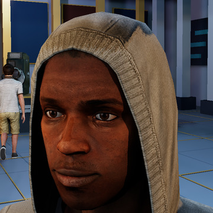</a> |
| Sparse GI + reflections | Off | 131.4 | 3.49 | 7.61 | <a href="images/room0__sparse_gi_reflections__off.jpg">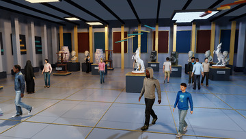</a> | <a href="images/person11_face__sparse_gi_reflections__off.jpg">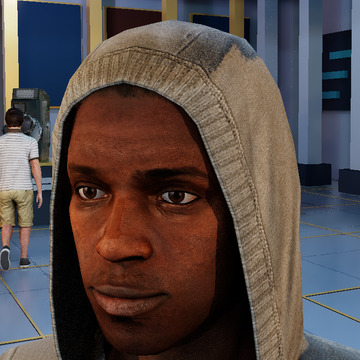</a> |
| Light + detail | Off | 121.5 | 3.18 | 8.23 |  | <a href="images/person11_face__light_detail__off.jpg">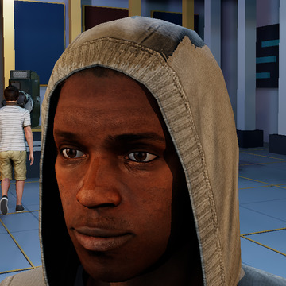</a> |
| **Very light** | 🟣 **Full frame** | **95.0** | **7.13** | **10.52** |  | <a href="images/person11_face__very_light__full_frame.jpg">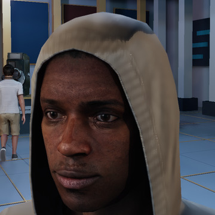</a> |
| **Very light** | 🟣 **Protected surfaces** | **93.2** | **7.15** | **10.73** |  |  |
| **Light + detail + soft shadows** | 🟣 **Protected surfaces** | **82.5** | **7.24** | **12.12** |  | <a href="images/person11_face__soft_shadows__protected.jpg">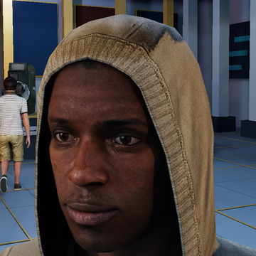</a> |
| **Light + detail + soft shadows** | 🟣 **Full frame** | **82.0** | **7.25** | **12.20** | <a href="images/room0__soft_shadows__full_frame.jpg">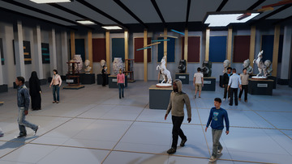</a> |  |
| **Sparse GI + reflections** | 🟣 **Full frame** | **81.6** | **7.47** | **12.26** | <a href="images/room0__sparse_gi_reflections__full_frame.jpg">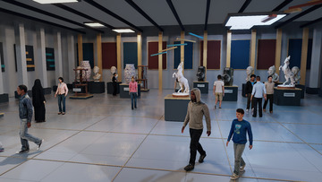</a> | <a href="images/person11_face__sparse_gi_reflections__full_frame.jpg">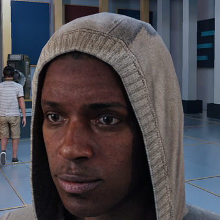</a> |
| **Light + detail** | 🟣 **Full frame** | **80.1** | **7.18** | **12.48** |  | <a href="images/person11_face__light_detail__full_frame.jpg">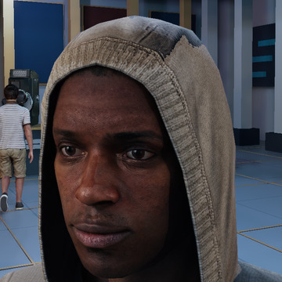</a> |
| **Room bounce + contact** | 🟣 **Full frame** | **78.8** | **7.22** | **12.70** | <a href="images/room0__room_bounce_contact__full_frame.jpg">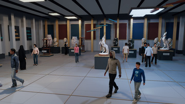</a> | <a href="images/person11_face__room_bounce_contact__full_frame.jpg">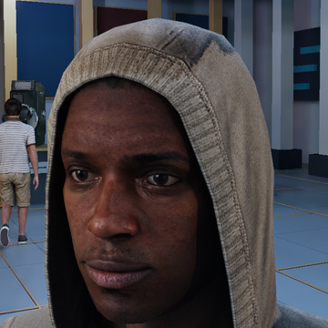</a> |
| **Sparse GI + reflections** | 🟣 **Protected surfaces** | **78.6** | **7.47** | **12.72** |  | <a href="images/person11_face__sparse_gi_reflections__protected.jpg">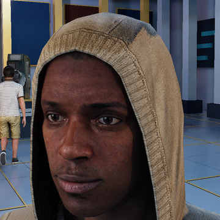</a> |
| **Light + detail** | 🟣 **Protected surfaces** | **77.9** | **7.14** | **12.84** | <a href="images/room0__light_detail__protected.jpg">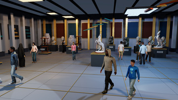</a> | <a href="images/person11_face__light_detail__protected.jpg">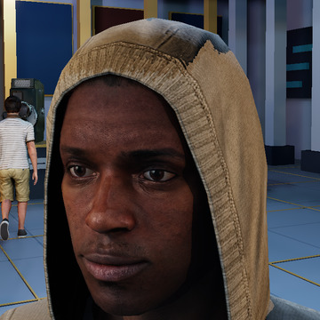</a> |
| **Room bounce + contact** | 🟣 **Protected surfaces** | **76.4** | **7.24** | **13.09** |  | <a href="images/person11_face__room_bounce_contact__protected.jpg">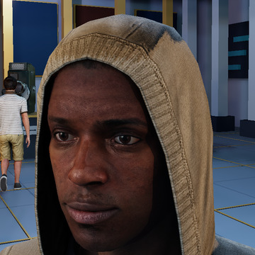</a> |
| Middle | Off | 72.5 | 10.56 | 13.79 |  |  |
| **Middle** | 🟣 **Full frame** | **54.1** | **14.49** | **18.50** | <a href="images/room0__middle__full_frame.jpg">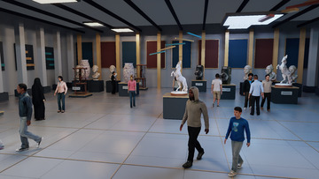</a> | <a href="images/person11_face__middle__full_frame.jpg">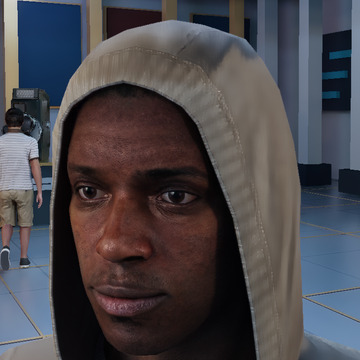</a> |
| **Middle** | 🟣 **Protected surfaces** | **53.8** | **14.47** | **18.58** | <a href="images/room0__middle__protected.jpg">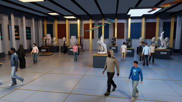</a> | <a href="images/person11_face__middle__protected.jpg">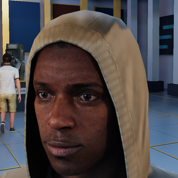</a> |
| Beauty | Off | 23.9 | 37.18 | 41.79 |  |  |
| **Beauty** | 🟣 **Protected surfaces** | **21.6** | **41.35** | **46.40** | <a href="images/room0__beauty__protected.jpg">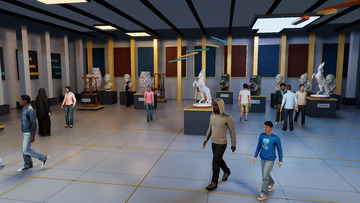</a> | <a href="images/person11_face__beauty__protected.jpg">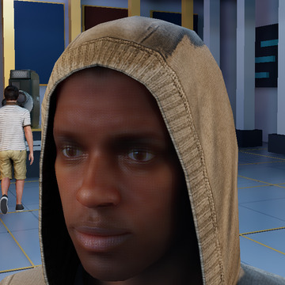</a> |
| **Beauty** | 🟣 **Full frame** | **21.2** | **41.67** | **47.23** |  | <a href="images/person11_face__beauty__full_frame.jpg">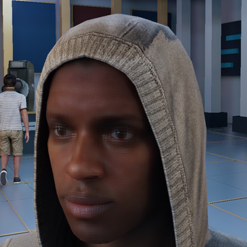</a> |
